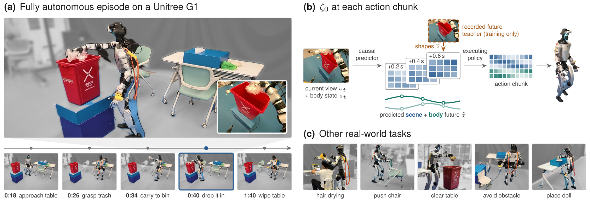
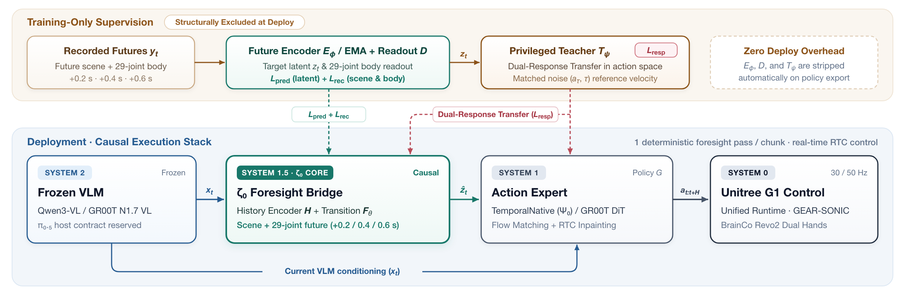
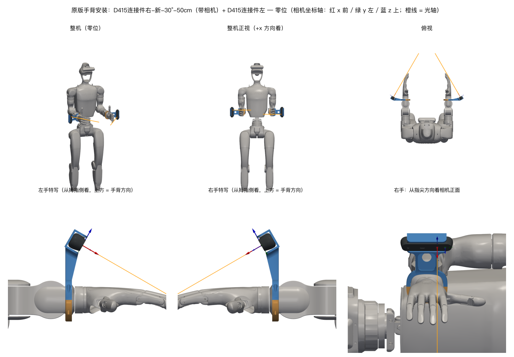
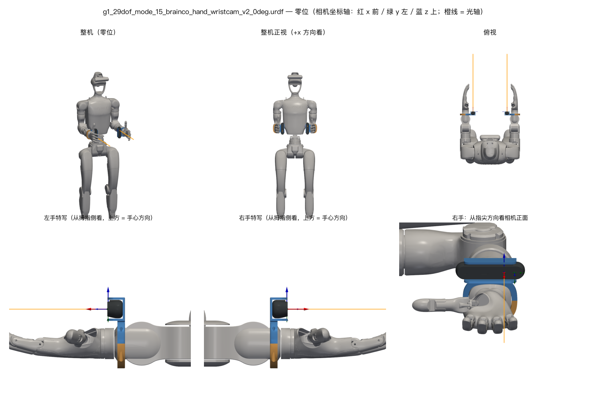

<div align="center">

# ζ₀ (Zeta0)

### A Framework for World Action Models with Joint Scene and Body Foresight in Humanoid Control

[](https://chenyizhi123.github.io/zeta0-project/)
[-334155?style=flat-square)](https://chenyizhi123.github.io/zeta0-project/assets/Zeta0-Humanoid-Full.pdf)
[-187769?style=flat-square)](https://huggingface.co/datasets/SII-yizhi/zeta0-real-dataset)
[](https://github.com/chenyizhi123/Zeta0/releases/tag/v0.2.0)
[](LICENSE)

**English** | [简体中文](README_zh.md) · [Real G1 Demos](#real-world-unitree-g1-demos) · [Method](#method--layered-architecture-system-2--15--1--0) · [4 Real-Robot Pillars](#four-open-source-real-robot-pillars) · [3D-Printable Mounts](#3d-printable-wrist-camera-mounts-unitree-g1--d415) · [Quick Start](#quick-start-30-seconds-on-cpu) · [Citation](#citation)

<br/>

<a href="https://chenyizhi123.github.io/zeta0-project/assets/videos/zeta0_overview_public.mp4">
  
</a>

<sub><b>ζ₀</b> turns layered / dual-system VLAs (<b>Ψ₀</b>, <b>GR00T N1.7</b>, and future <b>π₀.₅</b>) into <b>World Action Models</b> by foreseeing future scene features and all 29 measured whole-body joints (+0.2 / +0.4 / +0.6 s) from causal inputs, supervised in action space via <b>Dual-Response Transfer</b>. Click the teaser above to watch the overview video.</sub>

</div>

---

## News

- **`[2026-11]` `v0.2.0` Released**: Full real-robot open-source stack for **Unitree G1 + GEAR-SONIC + BrainCo Revo2** — including **no-private-weights** training (`--init-mode scratch` with Qwen3-VL / Cosmos-Reason2-2B & `--init-mode gr00t_n1d7` with NVIDIA GR00T N1.7-3B), unified G1 RTC deployment, `import zeta0` SDK, and verified 3D-printable D415 wrist mounts in [Release `v0.2.0`](https://github.com/chenyizhi123/Zeta0/releases/tag/v0.2.0).
- **`[2026-11]` Public Real-Robot Dataset**: Released [`SII-yizhi/zeta0-real-dataset`](https://huggingface.co/datasets/SII-yizhi/zeta0-real-dataset) (**739 episodes · 872,409 frames · 6 primary + 1 additional real G1 tasks**).
- **`[2026-11]` Project Page & Paper**: Interactive real-robot rollouts and full 18-page PDF are live at [chenyizhi123.github.io/zeta0-project](https://chenyizhi123.github.io/zeta0-project/).

---

## Start Where You Need

| If you want to... | Go straight to |
| :--- | :--- |
| **Print the G1 RealSense D415 wrist mounts** | [Download `hardware-wrist-camera-v1.tar.gz`](https://github.com/chenyizhi123/Zeta0/releases/download/v0.2.0/hardware-wrist-camera-v1.tar.gz) · [Print Specs & BOM](hardware/README.md) |
| **Download the public real G1 dataset (739 ep)** | [`SII-yizhi/zeta0-real-dataset`](https://huggingface.co/datasets/SII-yizhi/zeta0-real-dataset) · `zeta data pull real --tasks place_chair --execute` |
| **Collect, train & deploy on Unitree G1** | [4 Real-Robot Pillars](#four-open-source-real-robot-pillars) · [G1 Capture & Deploy](real/g1/README.md) · [Training Guide](docs/real_data_final_method.md) |
| **Plug ζ₀ foresight into your layered VLA** | [30s CPU Demo](#quick-start-30-seconds-on-cpu) · [`zeta0.hosts`](src/psi/models/predictive_world/hosts/) · [Backend Guide](docs/backends.md) |

---

## Real-World Unitree G1 Demos

Autonomous closed-loop rollouts on a physical **Unitree G1 + GEAR-SONIC WBC + BrainCo Revo2 hands** with Real-Time Chunking (RTC). Click any card to play the full rollout video (3rd-person + head/wrist camera PiP):

<table>
  <tr>
    <td align="center" width="33%">
      <a href="https://chenyizhi123.github.io/zeta0-project/assets/videos/real_01_tidy_scene.mp4">
        
      </a>
      <br/><b>Tidy Scene</b> (5-stage · 200 ep)<br/><sub><code>real/tidy_scene.zip</code> · 30 Hz</sub>
    </td>
    <td align="center" width="33%">
      <a href="https://chenyizhi123.github.io/zeta0-project/assets/videos/real_05_clear_table.mp4">
        
      </a>
      <br/><b>Clear Table Trash</b> (Multi-stage · 86 ep)<br/><sub><code>real/clean_table_trash.zip</code> · 30 Hz</sub>
    </td>
    <td align="center" width="33%">
      <a href="https://chenyizhi123.github.io/zeta0-project/assets/videos/real_06_avoid_obstacle.mp4">
        
      </a>
      <br/><b>Avoid Obstacle &amp; Place Tape</b> (100 ep)<br/><sub><code>real/place_tape_on_table.zip</code> · 30 Hz</sub>
    </td>
  </tr>
  <tr>
    <td align="center" width="33%">
      <a href="https://chenyizhi123.github.io/zeta0-project/assets/videos/real_02_hair_drying.mp4">
        
      </a>
      <br/><b>Blow-Dry Hair</b> (Human interaction · 81 ep)<br/><sub><code>real/blow_dry_hair.zip</code> · 30 Hz</sub>
    </td>
    <td align="center" width="33%">
      <a href="https://chenyizhi123.github.io/zeta0-project/assets/videos/real_03_push_chair.mp4">
        
      </a>
      <br/><b>Place Chair</b> (Loco-manipulation · 101 ep)<br/><sub><code>real/place_chair.zip</code> · 30 Hz</sub>
    </td>
    <td align="center" width="33%">
      <a href="https://chenyizhi123.github.io/zeta0-project/assets/videos/real_04_place_doll.mp4">
        
      </a>
      <br/><b>Place Doll</b> (Precision pick &amp; place · 100 ep)<br/><sub><code>real/place_doll.zip</code> · 50 Hz</sub>
    </td>
  </tr>
</table>

---

## Key Results

| Benchmark / Metric | Base Policy | **ζ₀ (Ours)** | Gain | Details |
| :--- | :---: | :---: | :---: | :--- |
| **HumanoidArena (7-task avg, Ψ₀)** | 44.8% | **63.6%** | **+18.8 pp** | 420 episodes/setting · `zeta_native` |
| **HumanoidArena (7-task avg, GR00T N1.7)** | 70.5% | **79.5%** | **+9.0 pp** | Best multi-task whole-body policy · `gr00t_n1d7` |
| **Real-World Unitree G1 (6 tasks, Ψ₀)** | 61.7% | **78.3%** | **+16.7 pp** | 300 physical trials · **+26.7 pp** on multi-stage tasks |
| **Real-World Unitree G1 (6 tasks, GR00T N1.7)** | 75.0% | **85.0%** | **+10.0 pp** | SONIC whole-body control + BrainCo hands + RTC |
| **29-Joint Body Forecast (+0.6 s RMSE)** | 9.36° (hold) | **4.53°** | **−51.6%** | Wins in 83.5% of 526 windows (legs: 5.23° vs 12.54°) |
| **Closed-Loop Latency (RTX 4090 / H200)** | — | **212 ms** | **6.3 GiB** | Single deterministic forecast per chunk (H200 `torch.compile` S1.5+S1: **105.9 ms / 1.82 GiB**) |

---

## Method & Layered Architecture (`System 2 → 1.5 → 1 → 0`)

<p align="center">
  
</p>

<p align="center">
  
</p>

<details>
<summary><b>View 29-Joint Whole-Body Forecast Figure &amp; Layered Host Matrix</b></summary>

<p align="center">
  
</p>

| Model Host | `model.host_architecture` | Status | Action Grid / Solver | Template / Module |
| :--- | :--- | :---: | :---: | :--- |
| **Ψ₀-derived** | `zeta_native` | Supported (Train + Export + G1 Deploy) | 50 steps @ 30 Hz or 30 @ 50 Hz · 10 Euler | [`configs/psi0/joint.template.json`](configs/psi0/joint.template.json) |
| **Native GR00T N1.7** | `gr00t_n1d7` | Supported (Train + Export + G1 Deploy) | 40 steps @ 30 Hz or 50 Hz · 4 Euler | [`configs/gr00t_n1d7/joint.template.json`](configs/gr00t_n1d7/joint.template.json) |
| **π₀.₅ (PaliGemma + Gemma)** | `pi05` | Contract Reserved (`kv_cache` + dynamic `visual_dim`) | 50 steps · 10 Euler | [`src/psi/models/predictive_world/hosts/pi05.py`](src/psi/models/predictive_world/hosts/pi05.py) |

</details>

---

## Four Open-Source Real-Robot Pillars

| Pillar | What's Included | Entrypoints |
| :--- | :--- | :--- |
| **1. Hardware Kit (3D-Printable)** | RealSense D415 wrist mounts (paper `+30°` back-of-hand & expanded `−20°..+20°` palm-side, recommended `0°`), print specs, M3 BOM, URDF previews & SHA-256 manifest | [`hardware/README.md`](hardware/README.md) · [`v0.2.0` Release](https://github.com/chenyizhi123/Zeta0/releases/tag/v0.2.0) |
| **2. Real G1 Collection** | PICO / XRoboToolkit teleop + GEAR-SONIC WBC + BrainCo Revo2 dual-hand + 3× D415 recording into LeRobot v3 (`state41` / `motion76`), plus offline audit (`zeta data inspect`) | [`real/g1/README.md`](real/g1/README.md#collection) · [Data Inspection](docs/framework.md#inspect-captured-data) |
| **3. Real-Robot Training** | **No-private-weights** v6/raw training from public **Qwen3-VL / Cosmos-Reason2-2B** (`--init-mode scratch`) or **NVIDIA GR00T N1.7-3B** (`--init-mode gr00t_n1d7`, 30 Hz & 50 Hz) | [`prepare_sonic_lerobot_task.py`](scripts/train/predictive_world/prepare_sonic_lerobot_task.py) · [Real-Data Recipe](docs/real_data_final_method.md) |
| **4. Real G1 Deployment** | Unified G1 runtime (`unified`) + `real_sonic_server` supporting `zeta_native` & `gr00t_n1d7` with RTC inpainting + hardware-free `mock_g1_client.py` + `zeta visualize log` | [`real/g1/runtime_profiles/README.md`](real/g1/runtime_profiles/README.md) · [G1 Deployment](real/g1/README.md#deployment) |

<details>
<summary><b>Expand: Train, Export &amp; Serve on Real G1 Data (No Private Checkpoints Required)</b></summary>

```bash
# Option A: Train Zeta-0 (Ψ₀ / zeta_native) from scratch with any public Qwen3-VL-2B / Cosmos-Reason2-2B
PYTHONPATH=src python scripts/train/predictive_world/prepare_sonic_lerobot_task.py \
  --init-mode scratch --dataset /path/to/place_chair --task real/place_chair \
  --qwen-model /path/to/Qwen3-VL-2B --output runs/place_chair_scratch \
  --current-state-only --fixed-action-grid --whole-body-target --action-horizon 50 \
  --gpus 1 --batch 64 --updates 20000

# Option B: Train Zeta-0 on native NVIDIA GR00T N1.7-3B (30 Hz / 40-step action chunk) & deploy to G1
PYTHONPATH=src python scripts/train/gr00t_n1d7/export_backbone.py \
  --base /path/to/GR00T-N1.7-3B --cosmos-processor /path/to/Cosmos-Reason2-2B --output assets/gr00t_n1d7_backbone
PYTHONPATH=src python scripts/train/predictive_world/prepare_sonic_lerobot_task.py \
  --init-mode gr00t_n1d7 --dataset /path/to/place_chair --task real/place_chair \
  --qwen-model assets/gr00t_n1d7_backbone --gr00t-model /path/to/GR00T-N1.7-3B \
  --output runs/place_chair_gr00t --current-state-only --fixed-action-grid --whole-body-target \
  --gpus 1 --batch 64 --updates 20000

# Cache visual features -> Train -> Export -> Serve (pass --gr00t-model for gr00t_n1d7)
PYTHONPATH=src python scripts/data/cache_predictive_world_features.py \
  --index runs/place_chair_gr00t/artifacts/predictive_world_index.jsonl \
  --provenance runs/place_chair_gr00t/artifacts/feature_provenance.json \
  --model assets/gr00t_n1d7_backbone --output runs/place_chair_gr00t/artifacts/feature_cache
PYTHONPATH=src python scripts/train/predictive_world/train.py --config runs/place_chair_gr00t/config.json
PYTHONPATH=src python scripts/export_real_sonic_research_policy.py \
  --checkpoint runs/place_chair_gr00t/joint/joint-final \
  --config runs/place_chair_gr00t/config.json --output runs/place_chair_gr00t/deploy_pkg
PYTHONPATH=src python -m psi.deploy.real_sonic_server \
  --weights-dir runs/place_chair_gr00t/deploy_pkg \
  --qwen-model assets/gr00t_n1d7_backbone --gr00t-model /path/to/GR00T-N1.7-3B
```

</details>

<details>
<summary><b>Expand: Public Real-Robot Dataset Breakdown (739 Unitree G1 Episodes)</b></summary>

| Asset | HuggingFace Repo | Specs |
| :--- | :--- | :--- |
| **Real-World G1 (6+1 Tasks)** | [`SII-yizhi/zeta0-real-dataset`](https://huggingface.co/datasets/SII-yizhi/zeta0-real-dataset) | Public · 739 ep · 872,409 rows (~24.4 GB, task ZIPs + `SHA256SUMS`) · 5× 30 Hz flat (`sonic_lerobot`) + 2× 50 Hz split (`real_sonic`, incl. `additional/flatten_box.zip`) |
| **Base Models & Hardware SDKs** | [Asset Catalog](docs/public_assets.md) | Qwen3-VL / Cosmos-Reason2-2B / Ψ₀, NVIDIA GR00T N1.7-3B, GEAR-SONIC WBC, BrainCo SDK, XRoboToolkit |

```bash
# Plan or pull a single real G1 task (~1.14 GB) or all tasks (add --execute to download)
zeta data pull real --tasks place_chair --output data/zeta0-real
zeta data pull real --output data/zeta0-real
```

</details>

---

## 3D-Printable Wrist Camera Mounts (Unitree G1 + D415)

<table>
  <tr>
    <td align="center" width="50%">
      
      <br/><b>Paper Mount (Back of Hand · +30°)</b><br/>
      <sub><code>d415_wrist_30deg.stl</code> · <code>d415_wrist_left.stl</code></sub>
    </td>
    <td align="center" width="50%">
      
      <br/><b>Expanded Mount (Palm Side · 0° Recommended)</b><br/>
      <sub>Angles: <code>−20°</code>, <code>−10°</code>, <b><code>0°</code></b>, <code>+10°</code>, <code>+20°</code> · <a href="hardware/wrist-camera-expansion/urdf_neg20deg.png">−20°</a> · <a href="hardware/wrist-camera-expansion/urdf_neg10deg.png">−10°</a> · <a href="hardware/wrist-camera-expansion/urdf_10deg.png">+10°</a> · <a href="hardware/wrist-camera-expansion/urdf_20deg.png">+20°</a></sub>
    </td>
  </tr>
</table>

> **Download STLs + Camera FOV Preview Videos**: [`hardware-wrist-camera-v1.tar.gz`](https://github.com/chenyizhi123/Zeta0/releases/download/v0.2.0/hardware-wrist-camera-v1.tar.gz) (`57.8 MB`, SHA-256 verified against [`hardware/assets_manifest.json`](hardware/assets_manifest.json)). Recommended print settings: **PETG / ABS / PA-CF**, `0.20 mm` layer height, `4` wall loops, `30–40%` gyroid infill, rear `M3` (`<= 5 mm` thread depth). Full guide in [`hardware/README.md`](hardware/README.md).

---

## Quick Start (30 Seconds on CPU)

Run the complete Zeta-0 stack (`E/EMA` + `D` + `F prior/world` + `T/G` Dual-Response Transfer + checkpoint resume + causal `PredictiveWorldPolicy` + `foresight_preview.png` visual plot) on CPU with **zero downloads or robot hardware**:

```bash
git clone https://github.com/chenyizhi123/Zeta0.git && cd Zeta0
uv venv --python 3.10 .venv-check
uv pip install --python .venv-check/bin/python torch==2.7.0 --index-url https://download.pytorch.org/whl/cpu
uv pip install --python .venv-check/bin/python --group cpu-test
make demo PYTHON=.venv-check/bin/python
```

<details>
<summary><b>Expand: Python SDK (<code>import zeta0</code>) &amp; Complete <code>zeta</code> CLI Cheatsheet</b></summary>

```python
import zeta0
from zeta0.core import (
    FutureTrajectoryEncoder,
    WorldReadout,
    TemporalLatentTransition,
    JointObjective,
    PredictiveWorldPolicy,
)
from zeta0.hosts import list_hosts

print(zeta0.__version__, list_hosts())
# 0.2.0 ('gr00t_n1d7', 'pi05', 'zeta_native')
```

```bash
# Environment doctor & registered layered VLA hosts
PYTHONPATH=src python -m psi.cli doctor --profile train --python /path/to/python
PYTHONPATH=src python -m psi.cli hosts

# Scaffold a v6/raw training config without hand-editing template JSONs
zeta init --host gr00t_n1d7 --qwen-model /path/to/backbone --gr00t-model /path/to/GR00T-N1.7-3B --output configs/runs/task.json

# Hardware-free G1 RTC dry-run + visualize telemetry / foresight plots
PYTHONPATH=src python scripts/deploy/mock_g1_client.py --in-process --cycles 12 --output runs/mock_g1_trace.jsonl
zeta visualize log runs/mock_g1_trace.jsonl --output runs/rtc_dashboard.png
zeta visualize rollout runs/quickstart-*/summary.json --output runs/foresight.png

# Benchmark deploy-only latency (CPU or CUDA, eager vs --compile)
PYTHONPATH=src python scripts/benchmark_inference.py --preset tiny-cpu --device cpu
```

Also see: [Installation](docs/installation.md) · [Dockerfiles](docker/README.md) · [Workflows](docs/workflows.md) · [CLI Guide](docs/framework.md).

</details>

---

## Open-Source Release Checklist

- [x] Real-world Unitree G1 + SONIC + BrainCo dataset ([`SII-yizhi/zeta0-real-dataset`](https://huggingface.co/datasets/SII-yizhi/zeta0-real-dataset), 6+1 tasks, 739 episodes)
- [x] 3D-printable RealSense D415 wrist camera mounts + print specs + SHA-256 bundle ([`v0.2.0`](https://github.com/chenyizhi123/Zeta0/releases/tag/v0.2.0))
- [x] Real G1 capture, standalone no-private-weights training (`Ψ₀` & `GR00T N1.7`, 30 Hz & 50 Hz), and unified RTC deployment
- [x] Full-algorithm CPU quickstart, `zeta0` SDK, visualization dashboards, mock G1 client, and Dockerfiles

---

## Citation

If you find **Zeta0** useful in your research or robot deployment, please cite:

```bibtex
@article{chen2026zeta0,
  title   = {$\zeta_0$: A Framework for World Action Models with Joint Scene and Body Foresight in Humanoid Control},
  author  = {Chen, Yizhi and Cao, Zhanxiang and Wang, Yitong and Liu, Junyu and Zeng, Hongchu and Peng, Xinyi and Huang, Chuxuan and Su, Yicheng and Zhou, Zihao and Fu, Shengcheng and Li, Haoyang and Yan, Liyun and Zhan, Tianyue and Ma, Jianming and Zhang, Yang and Zhu, Keqi and Si, Xiaxi and Yao, Jinming and Sun, Qiao and Zhang, Shizeng and Zhong, Jiangwei and Gao, Yue},
  journal = {arXiv preprint},
  year    = {2026},
  url     = {https://chenyizhi123.github.io/zeta0-project/}
}
```

---

## Documentation, Acknowledgments & Licenses

[Documentation Index](docs/README.md) · [中文文档导航](docs/README_zh.md) · [Roadmap](ROADMAP.md) · [Changelog](CHANGELOG.md) · [Contributing](CONTRIBUTING.md)

We gratefully acknowledge the open-source projects built upon in Zeta0:
- [Ψ₀](https://github.com/physical-superintelligence-lab/Psi0): inherited and adapted code in the training library and deployment runtimes.
- [Isaac-GR00T](https://github.com/NVIDIA/Isaac-GR00T): native N1.7 action head used by the `gr00t_n1d7` backend.
- [LeRobot](https://github.com/huggingface/lerobot) and [GR00T-WholeBodyControl](https://github.com/physical-superintelligence-lab/GR00T-WholeBodyControl): G1 capture and SONIC whole-body control integrations.

See [LICENSE](LICENSE), [NOTICE](NOTICE), and [THIRD_PARTY_NOTICES.md](THIRD_PARTY_NOTICES.md).
