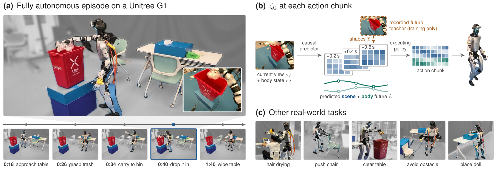
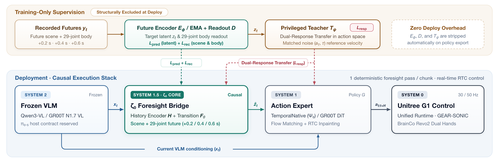
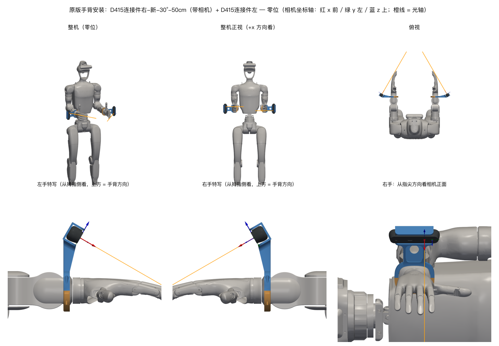

<div align="center">

# ζ₀ (Zeta0)

### 面向人形机器人控制的联合场景与身体预见世界动作模型框架

[](https://chenyizhi123.github.io/zeta0-project/)
[-334155?style=flat-square)](https://chenyizhi123.github.io/zeta0-project/assets/Zeta0-Humanoid-Full.pdf)
[-187769?style=flat-square)](https://huggingface.co/datasets/SII-yizhi/zeta0-real-dataset)
[](https://github.com/chenyizhi123/Zeta0/releases/tag/v0.2.0)
[](LICENSE)

[English](README.md) | **简体中文** · [真机实测画廊](#unitree-g1-真机演示画廊) · [方法与分层架构](#方法与分层架构system-2--15--1--0) · [四大真机主线](#四大真机开源主线) · [3D 打印支架](#开源-3d-打印腕部相机支架unitree-g1--d415) · [30 秒体验](#30-秒快速开始纯-cpu无需权重或真机) · [引用](#引用)

<br/>

<a href="https://chenyizhi123.github.io/zeta0-project/assets/videos/zeta0_overview_public.mp4">
  
</a>

<sub><b>ζ₀</b> 通过在共享潜表示中从因果观测联合预见未来视觉特征与全部 29 个实测全身关节轨迹（+0.2 / +0.4 / +0.6 s），并结合动作空间<b>双响应迁移（Dual-Response Transfer）</b>，将分层 VLA（<b>Ψ₀</b>、<b>GR00T N1.7</b> 及规划中的 <b>π₀.₅</b>）升级为<b>世界动作模型（WAM）</b>。点击上方主图可观看总览视频。</sub>

</div>

---

## 最新动态

- **`[2026-11]` 发布 `v0.2.0`**：完整开源 **Unitree G1 + GEAR-SONIC + BrainCo Revo2** 四大真机主线——提供**免私有权重**真机训练（公开 Qwen3-VL / Cosmos-Reason2-2B `--init-mode scratch` 与 NVIDIA GR00T N1.7-3B `--init-mode gr00t_n1d7`）、统一 G1 RTC 部署运行时、`import zeta0` Python SDK 及已校验的 3D 打印腕部支架包（[Release `v0.2.0`](https://github.com/chenyizhi123/Zeta0/releases/tag/v0.2.0)）。
- **`[2026-11]` 公开真机 G1 数据集**：[`SII-yizhi/zeta0-real-dataset`](https://huggingface.co/datasets/SII-yizhi/zeta0-real-dataset) 现已全面公开（**739 条轨迹 · 872,409 帧 · 6 主任务 + 1 附加任务**）。
- **`[2026-11]` 项目主页与完整论文上线**：交互式真机演示与 18 页完整论文 PDF 请见 [chenyizhi123.github.io/zeta0-project](https://chenyizhi123.github.io/zeta0-project/)。

---

## 30 秒定位入口

| 如果你想…… | 直达链接 |
| :--- | :--- |
| **直接 3D 打印 G1 RealSense D415 腕部支架** | [下载 `hardware-wrist-camera-v1.tar.gz`](https://github.com/chenyizhi123/Zeta0/releases/download/v0.2.0/hardware-wrist-camera-v1.tar.gz) · [打印参数与螺丝 BOM](hardware/README.md) |
| **下载已公开的真机 G1 数据集（739 局）** | [`SII-yizhi/zeta0-real-dataset`](https://huggingface.co/datasets/SII-yizhi/zeta0-real-dataset) · `zeta data pull real --tasks place_chair --execute` |
| **在 Unitree G1 上复现采数 → 训练 → 部署** | [四大真机主线](#四大真机开源主线) · [G1 采集与部署指南](real/g1/README.md) · [真机训练配方](docs/real_data_final_method.md) |
| **把 ζ₀ 预见模块接入你的分层 VLA 底座** | [30 秒 CPU 演示](#30-秒快速开始纯-cpu无需权重或真机) · [`zeta0.hosts`](src/psi/models/predictive_world/hosts/) · [双后端架构说明](docs/backends.md) |

---

## Unitree G1 真机演示画廊

物理 **Unitree G1 + GEAR-SONIC 全身控制 + BrainCo Revo2 灵巧手** 闭环自主执行（RTC 实时分块）。点击任意画面直接观看真机视频（含第三人称 + 头部/腕部视角画中画）：

<table>
  <tr>
    <td align="center" width="33%">
      <a href="https://chenyizhi123.github.io/zeta0-project/assets/videos/real_01_tidy_scene.mp4">
        
      </a>
      <br/><b>整理场景 Tidy Scene</b>（五阶段长程 · 200 局）<br/><sub><code>real/tidy_scene.zip</code> · 30 Hz</sub>
    </td>
    <td align="center" width="33%">
      <a href="https://chenyizhi123.github.io/zeta0-project/assets/videos/real_05_clear_table.mp4">
        
      </a>
      <br/><b>清理桌面垃圾 Clear Table</b>（多阶段 · 86 局）<br/><sub><code>real/clean_table_trash.zip</code> · 30 Hz</sub>
    </td>
    <td align="center" width="33%">
      <a href="https://chenyizhi123.github.io/zeta0-project/assets/videos/real_06_avoid_obstacle.mp4">
        
      </a>
      <br/><b>绕障放置胶带 Place Tape</b>（100 局）<br/><sub><code>real/place_tape_on_table.zip</code> · 30 Hz</sub>
    </td>
  </tr>
  <tr>
    <td align="center" width="33%">
      <a href="https://chenyizhi123.github.io/zeta0-project/assets/videos/real_02_hair_drying.mp4">
        
      </a>
      <br/><b>为人吹头发 Blow-Dry Hair</b>（人机交互 · 81 局）<br/><sub><code>real/blow_dry_hair.zip</code> · 30 Hz</sub>
    </td>
    <td align="center" width="33%">
      <a href="https://chenyizhi123.github.io/zeta0-project/assets/videos/real_03_push_chair.mp4">
        
      </a>
      <br/><b>摆放椅子 Place Chair</b>（移动操作 · 101 局）<br/><sub><code>real/place_chair.zip</code> · 30 Hz</sub>
    </td>
    <td align="center" width="33%">
      <a href="https://chenyizhi123.github.io/zeta0-project/assets/videos/real_04_place_doll.mp4">
        
      </a>
      <br/><b>放置玩偶 Place Doll</b>（精细抓取 · 100 局）<br/><sub><code>real/place_doll.zip</code> · 50 Hz</sub>
    </td>
  </tr>
</table>

---

## 核心实验结果

| 基准 / 指标 | 底座基线 | **ζ₀（本文）** | 提升 | 说明 |
| :--- | :---: | :---: | :---: | :--- |
| **HumanoidArena（7 任务均值，Ψ₀）** | 44.8% | **63.6%** | **+18.8 pp** | 每设置 420 局 · `zeta_native` |
| **HumanoidArena（7 任务均值，GR00T N1.7）** | 70.5% | **79.5%** | **+9.0 pp** | 超过所有对比七任务联合策略 · `gr00t_n1d7` |
| **Unitree G1 真机（6 任务，Ψ₀）** | 61.7% | **78.3%** | **+16.7 pp** | 300 次物理实测 · 多阶段任务 **+26.7 pp** |
| **Unitree G1 真机（6 任务，GR00T N1.7）** | 75.0% | **85.0%** | **+10.0 pp** | SONIC 全身控制 + BrainCo 灵巧手 + RTC |
| **29 关节未来身体预测（+0.6 s RMSE）** | 9.36°（保持） | **4.53°** | **−51.6%** | 526 个窗口胜率 83.5%（腿部 5.23° vs 12.54°） |
| **闭环推理延迟（RTX 4090 / H200）** | — | **212 ms** | **6.3 GiB** | 每动作块仅一次确定性预见（H200 `torch.compile` S1.5+S1：**105.9 ms / 1.82 GiB**） |

---

## 方法与分层架构（`System 2 → 1.5 → 1 → 0`）

<p align="center">
  
</p>

<p align="center">
  
</p>

<details>
<summary><b>展开查看：29 关节全身预见精度图 &amp; 分层 Host 注册表</b></summary>

<p align="center">
  
</p>

| 模型底座 | `model.host_architecture` | 状态 | 动作网格 / 求解步数 | 模板 / 实现 |
| :--- | :--- | :---: | :---: | :--- |
| **Ψ₀-derived** | `zeta_native` | 已支持（训练 + 导出 + G1 统一部署） | 50 步 @ 30 Hz 或 30 步 @ 50 Hz · 10 步 Euler | [`configs/psi0/joint.template.json`](configs/psi0/joint.template.json) |
| **原生 GR00T N1.7** | `gr00t_n1d7` | 已支持（训练 + 导出 + G1 统一部署） | 40 步 @ 30 Hz 或 50 Hz · 4 步 Euler | [`configs/gr00t_n1d7/joint.template.json`](configs/gr00t_n1d7/joint.template.json) |
| **π₀.₅（PaliGemma + Gemma）** | `pi05` | 契约已预留（支持 `kv_cache` 与动态 `visual_dim`） | 50 步 · 10 步 Euler | [`src/psi/models/predictive_world/hosts/pi05.py`](src/psi/models/predictive_world/hosts/pi05.py) |

</details>

---

## 四大真机开源主线

| 开源主线 | 核心内容 | 文档与入口 |
| :--- | :--- | :--- |
| **1. 硬件打印方案（3D 可打印）** | RealSense D415 腕部支架（论文版手背 `+30°` 与拓展版手心侧 `−20°..+20°`，推荐优先测试 `0°`）、打印参数/M3 螺丝 BOM、URDF 预览与 SHA-256 清单 | [`hardware/README.md`](hardware/README.md) · [`v0.2.0` Release](https://github.com/chenyizhi123/Zeta0/releases/tag/v0.2.0) |
| **2. 真机采集方案** | PICO / XRoboToolkit 遥操作 + GEAR-SONIC 全身控制 + BrainCo Revo2 灵巧手 + 三路 D415 直出 LeRobot v3（`state41` / `motion76`），配合 `zeta data inspect` 审计 | [`real/g1/README.md`](real/g1/README.md#collection) · [数据审计](docs/framework.md#inspect-captured-data) |
| **3. 真机训练方案（免私有权重）** | 支持从公开 **Qwen3-VL / Cosmos-Reason2-2B**（`--init-mode scratch`）或 **NVIDIA GR00T N1.7-3B**（`--init-mode gr00t_n1d7`，兼容 30 Hz 与 50 Hz）直接训练 v6/raw 策略 | [`prepare_sonic_lerobot_task.py`](scripts/train/predictive_world/prepare_sonic_lerobot_task.py) · [真机训练标准](docs/real_data_final_method.md) |
| **4. 真机部署方案** | 统一 G1 运行时（`unified`）与 `real_sonic_server`，原生支持 `zeta_native` 与 `gr00t_n1d7` RTC 在线推理，提供无真机 `mock_g1_client.py` 与 `zeta visualize log` | [`real/g1/runtime_profiles/README.md`](real/g1/runtime_profiles/README.md) · [G1 部署流程](real/g1/README.md#deployment) |

<details>
<summary><b>展开查看：真机数据免私有权重训练 → 导出 → 启动推理服务完整命令</b></summary>

```bash
# 方案 A：使用公开 Qwen3-VL-2B / Cosmos-Reason2-2B 从零训练 Zeta-0（Ψ₀ / zeta_native，30 Hz 真机数据）
PYTHONPATH=src python scripts/train/predictive_world/prepare_sonic_lerobot_task.py \
  --init-mode scratch --dataset /path/to/place_chair --task real/place_chair \
  --qwen-model /path/to/Qwen3-VL-2B --output runs/place_chair_scratch \
  --current-state-only --fixed-action-grid --whole-body-target --action-horizon 50 \
  --gpus 1 --batch 64 --updates 20000

# 方案 B：接入公开 NVIDIA GR00T N1.7-3B（30 Hz / 40 步动作块）训练并直出部署 G1
PYTHONPATH=src python scripts/train/gr00t_n1d7/export_backbone.py \
  --base /path/to/GR00T-N1.7-3B --cosmos-processor /path/to/Cosmos-Reason2-2B --output assets/gr00t_n1d7_backbone
PYTHONPATH=src python scripts/train/predictive_world/prepare_sonic_lerobot_task.py \
  --init-mode gr00t_n1d7 --dataset /path/to/place_chair --task real/place_chair \
  --qwen-model assets/gr00t_n1d7_backbone --gr00t-model /path/to/GR00T-N1.7-3B \
  --output runs/place_chair_gr00t --current-state-only --fixed-action-grid --whole-body-target \
  --gpus 1 --batch 64 --updates 20000

# 特征缓存 → 训练 → 导出推理包 → 启动服务（GR00T N1.7 附加 --gr00t-model）
PYTHONPATH=src python scripts/data/cache_predictive_world_features.py \
  --index runs/place_chair_gr00t/artifacts/predictive_world_index.jsonl \
  --provenance runs/place_chair_gr00t/artifacts/feature_provenance.json \
  --model assets/gr00t_n1d7_backbone --output runs/place_chair_gr00t/artifacts/feature_cache
PYTHONPATH=src python scripts/train/predictive_world/train.py --config runs/place_chair_gr00t/config.json
PYTHONPATH=src python scripts/export_real_sonic_research_policy.py \
  --checkpoint runs/place_chair_gr00t/joint/joint-final \
  --config runs/place_chair_gr00t/config.json --output runs/place_chair_gr00t/deploy_pkg
PYTHONPATH=src python -m psi.deploy.real_sonic_server \
  --weights-dir runs/place_chair_gr00t/deploy_pkg \
  --qwen-model assets/gr00t_n1d7_backbone --gr00t-model /path/to/GR00T-N1.7-3B
```

</details>

<details>
<summary><b>展开查看：公开真机数据集清单（739 局 Unitree G1）与按任务拉取命令</b></summary>

| 资产 | HuggingFace 地址 | 规格说明 |
| :--- | :--- | :--- |
| **真机 G1 数据集（6+1 任务）** | [`SII-yizhi/zeta0-real-dataset`](https://huggingface.co/datasets/SII-yizhi/zeta0-real-dataset) | 已公开 · 739 局 · 872,409 帧（约 24.4 GB，按任务 ZIP + `SHA256SUMS`）· 5 项 30 Hz 扁平（`sonic_lerobot`）+ 2 项 50 Hz 分列（`real_sonic`，含 `additional/flatten_box.zip`） |
| **基础模型与硬件 SDK** | [公开资产目录](docs/public_assets.md) | Qwen3-VL / Cosmos-Reason2-2B / Ψ₀、NVIDIA GR00T N1.7-3B、GEAR-SONIC、BrainCo SDK、XRoboToolkit |

```bash
# 按单任务预览或拉取真机数据（如 place_chair 约 1.14 GB）或全量拉取（加 --execute 执行下载）
zeta data pull real --tasks place_chair --output data/zeta0-real
zeta data pull real --output data/zeta0-real
```

</details>

---

## 开源 3D 打印腕部相机支架（Unitree G1 + D415）

<table>
  <tr>
    <td align="center" width="50%">
      
      <br/><b>论文版支架（手背安装 · +30°）</b><br/>
      <sub><code>d415_wrist_30deg.stl</code> · <code>d415_wrist_left.stl</code></sub>
    </td>
    <td align="center" width="50%">
      
      <br/><b>拓展版支架（手心一侧 · 推荐优先测试 0°）</b><br/>
      <sub>可选角度：<code>−20°</code>、<code>−10°</code>、<b><code>0°</code></b>、<code>+10°</code>、<code>+20°</code> · <a href="hardware/wrist-camera-expansion/urdf_neg20deg.png">−20°</a> · <a href="hardware/wrist-camera-expansion/urdf_neg10deg.png">−10°</a> · <a href="hardware/wrist-camera-expansion/urdf_10deg.png">+10°</a> · <a href="hardware/wrist-camera-expansion/urdf_20deg.png">+20°</a></sub>
    </td>
  </tr>
</table>

> **一键下载全部 STL 模型 + 相机视野预览视频**：[`hardware-wrist-camera-v1.tar.gz`](https://github.com/chenyizhi123/Zeta0/releases/download/v0.2.0/hardware-wrist-camera-v1.tar.gz)（`57.8 MB`，SHA-256 校验见 [`hardware/assets_manifest.json`](hardware/assets_manifest.json)）。推荐打印参数：**PETG / ABS / PA-CF**、`0.20 mm` 层高、`4` 层壁厚、`30–40%` 陀螺体填充、背部 `M3` 螺丝（旋入深度 `<= 5 mm`）。完整装配说明见 [`hardware/README.md`](hardware/README.md)。

---

## 30 秒快速开始（纯 CPU，无需权重或真机）

零下载跑通完整 Zeta-0 联合目标（`E/EMA` + `D` + `F prior/world` + `T/G` 双响应迁移 + 断点恢复校验 + 因果 `PredictiveWorldPolicy` + 自动生成 `foresight_preview.png` 可视化图）：

```bash
git clone https://github.com/chenyizhi123/Zeta0.git && cd Zeta0
uv venv --python 3.10 .venv-check
uv pip install --python .venv-check/bin/python torch==2.7.0 --index-url https://download.pytorch.org/whl/cpu
uv pip install --python .venv-check/bin/python --group cpu-test
make demo PYTHON=.venv-check/bin/python
```

<details>
<summary><b>展开查看：Python SDK（<code>import zeta0</code>）与 <code>zeta</code> 统一命令行速查</b></summary>

```python
import zeta0
from zeta0.core import (
    FutureTrajectoryEncoder,
    WorldReadout,
    TemporalLatentTransition,
    JointObjective,
    PredictiveWorldPolicy,
)
from zeta0.hosts import list_hosts

print(zeta0.__version__, list_hosts())
# 0.2.0 ('gr00t_n1d7', 'pi05', 'zeta_native')
```

```bash
# 环境体检与已注册的分层 VLA Host
PYTHONPATH=src python -m psi.cli doctor --profile train --python /path/to/python
PYTHONPATH=src python -m psi.cli hosts

# 一键生成 v6/raw 训练配置（免手改模板 JSON）
zeta init --host gr00t_n1d7 --qwen-model /path/to/backbone --gr00t-model /path/to/GR00T-N1.7-3B --output configs/runs/task.json

# 无需真机 G1 干跑验证 RTC 协议 + 输出延迟/预见可视化看板
PYTHONPATH=src python scripts/deploy/mock_g1_client.py --in-process --cycles 12 --output runs/mock_g1_trace.jsonl
zeta visualize log runs/mock_g1_trace.jsonl --output runs/rtc_dashboard.png
zeta visualize rollout runs/quickstart-*/summary.json --output runs/foresight.png

# 推理延迟基准（支持 CPU / CUDA 与 --compile）
PYTHONPATH=src python scripts/benchmark_inference.py --preset tiny-cpu --device cpu
```

更多指南：[安装说明](docs/installation.md) · [Docker 镜像](docker/README.md) · [工作流总览](docs/workflows.md) · [命令行指南](docs/framework.md)。

</details>

---

## 开源进度清单

- [x] Unitree G1 + SONIC + BrainCo 真机数据集公开（[`SII-yizhi/zeta0-real-dataset`](https://huggingface.co/datasets/SII-yizhi/zeta0-real-dataset)，6+1 任务，739 局）
- [x] RealSense D415 3D 打印腕部支架、打印参数与 SHA-256 资产包（[`v0.2.0`](https://github.com/chenyizhi123/Zeta0/releases/tag/v0.2.0)）
- [x] 真机采集、免私有权重训练（`Ψ₀` 与 `GR00T N1.7`，支持 30 Hz 与 50 Hz）与 G1 统一 RTC 部署
- [x] 完整算法 CPU 最小演示、`zeta0` SDK、可视化看板、无真机模拟 G1 客户端与 Dockerfile
- [ ] π₀.₅（`pi05`）完整 PaliGemma KV-Cache 底座接入（详见 [路线图](ROADMAP.md)）
- [ ] arXiv 正式编号更新及可选预训练权重发布

---

## 引用

如果 **Zeta0** 对你的研究或人形机器人部署有所帮助，欢迎引用：

```bibtex
@article{chen2026zeta0,
  title   = {$\zeta_0$: A Framework for World Action Models with Joint Scene and Body Foresight in Humanoid Control},
  author  = {Chen, Yizhi and Cao, Zhanxiang and Wang, Yitong and Liu, Junyu and Zeng, Hongchu and Peng, Xinyi and Huang, Chuxuan and Su, Yicheng and Zhou, Zihao and Fu, Shengcheng and Li, Haoyang and Yan, Liyun and Zhan, Tianyue and Ma, Jianming and Zhang, Yang and Zhu, Keqi and Si, Xiaxi and Yao, Jinming and Sun, Qiao and Zhang, Shizeng and Zhong, Jiangwei and Gao, Yue},
  journal = {arXiv preprint},
  year    = {2026},
  url     = {https://chenyizhi123.github.io/zeta0-project/}
}
```

---

## 文档、致谢与许可

[中文文档导航](docs/README_zh.md) · [英文文档索引](docs/README.md) · [路线图](ROADMAP.md) · [更新日志](CHANGELOG.md) · [贡献指南](CONTRIBUTING.md)

感谢 Zeta0 使用与致敬的开源项目：
- [Ψ₀](https://github.com/physical-superintelligence-lab/Psi0)：训练代码库和部署运行时中继承与修改的代码来源。
- [Isaac-GR00T](https://github.com/NVIDIA/Isaac-GR00T)：`gr00t_n1d7` 后端使用的原生 N1.7 动作头。
- [LeRobot](https://github.com/huggingface/lerobot) 与 [GR00T-WholeBodyControl](https://github.com/physical-superintelligence-lab/GR00T-WholeBodyControl)：G1 数据采集与 SONIC 全身控制集成。

许可与归属说明见 [LICENSE](LICENSE)、[NOTICE](NOTICE) 和 [第三方声明](THIRD_PARTY_NOTICES.md)。
