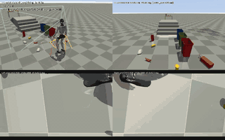
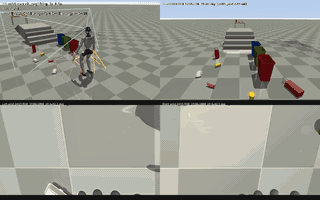
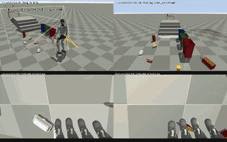
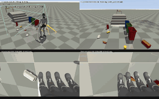
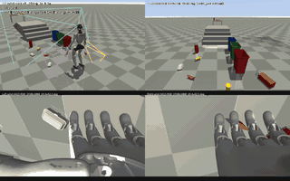

# Zeta0

**面向人形机器人 VLA 与 WAM 的数据采集、策略训练和真机部署。**

[English](README.md) | 简体中文

Zeta0 串接 Unitree G1 的示范采集、模型训练和策略执行。
Psi0-derived 与原生 GR00T N1.7 共用训练核心，真机工具接入 SONIC 全身控制和 BrainCo 灵巧手。


*Zeta-0 是框架中的当前模型，通过预测场景与身体的未来变化生成全身动作。
具体设计见[模型说明](docs/predictive_world.md)。*

## 已开源内容

**2026-11-22 · v0.1.0 首发。** 开放 G1 遥操作和 LeRobot v3 采集、数据准备、
Psi0-derived 与原生 GR00T N1.7 训练、检查点导出和配套 G1 部署运行时。
同时提供安装指南和离线测试。

为让真机动作衔接更流畅，部署端引入 RTC（Real-Time Chunking，实时动作分块），
在机器人执行当前动作段的同时预测下一段动作。

## 主要功能

- **采集和准备示范数据。** 以 LeRobot v3 记录 G1 示范，检查状态、动作和时间戳，准备任务训练数据。
- **使用两种模型后端训练。** Psi0-derived 与原生 GR00T N1.7 共享预测、训练目标、检查点和恢复工具。
- **在 G1 上部署策略。** 支持导出完成的联合训练检查点，也可搭配对应的历史任务运行时。
- **配置任务与排查问题。** 通过配置添加任务，用 `zeta` 检查模型包、汇总运行日志。

## 快速开始

```bash
git clone https://github.com/chenyizhi123/Zeta0.git
cd Zeta0
```

按[安装指南](docs/installation.md)选择环境。已有环境可以先[检查并复用](docs/framework.md#start-with-your-existing-environment)。

首次运行可尝试[最小示例](docs/quickstart.md)：用合成数据训练小型预测器，保存检查点后恢复训练。
准备好示例所需的 CPU 环境后运行：

```bash
make demo PYTHON=.venv-check/bin/python
```

结果保存在 `runs/quickstart-*`，其中 `summary.json` 给出重新加载和恢复训练的检查结果。
这个示例无需模型权重、数据集或机器人。

## 数据采集 → 策略训练 → 真机部署

| 目标 | 入口 |
| --- | --- |
| 采集 G1 示范 | [采集配置与录制](real/g1/README.md#collection)、[数据检查](docs/framework.md#inspect-captured-data) |
| 准备数据并训练 | [后端安装](docs/backends.md)、[数据准备与训练](docs/reproducibility.md) |
| G1 真机执行 | [研究推理服务和真机客户端](real/README.md)、[G1 任务运行时](real/g1/README.md#deployment) |

训练使用 Python 3.10，G1 采集使用 Python 3.12。文档中的 G1 数据准备和微调
配方使用 Psi0-derived 后端。原生 GR00T N1.7 也提供训练支持，按独立的数据输入要求
准备。历史 G1 任务运行时需要匹配的任务权重及观测、动作协议。详见
[工作流指南](docs/workflows.md)和[资产目录](docs/public_assets.md)。

## 腕部相机支架

[`hardware/`](hardware/) 目录提供用于在 G1 腕部安装 Intel RealSense D415 的 STL 模型和 URDF 预览。

| 支架 | 相机位置 | 预览 |
| --- | --- | --- |
| [论文版](hardware/wrist-camera-paper/) | 手背 | [30°](hardware/wrist-camera-paper/urdf_30deg.png) |
| [拓展版](hardware/wrist-camera-expansion/) | 手心一侧 | [−20°](hardware/wrist-camera-expansion/urdf_neg20deg.png), [−10°](hardware/wrist-camera-expansion/urdf_neg10deg.png), [0°](hardware/wrist-camera-expansion/urdf_0deg.png), [10°](hardware/wrist-camera-expansion/urdf_10deg.png), [20°](hardware/wrist-camera-expansion/urdf_20deg.png) |

建议先使用[拓展版 0° 支架](hardware/wrist-camera-expansion/D415-wrist-0%C2%B0.stl)进行测试。

| [−20°](hardware/wrist-camera-expansion/video/overview_neg20deg.mp4) | [−10°](hardware/wrist-camera-expansion/video/overview_neg10deg.mp4) | [**0°**](hardware/wrist-camera-expansion/video/overview_0deg.mp4) | [10°](hardware/wrist-camera-expansion/video/overview_10deg.mp4) | [20°](hardware/wrist-camera-expansion/video/overview_20deg.mp4) |
| :---: | :---: | :---: | :---: | :---: |
|  |  |  |  |  |

## 当前模型实现

Zeta-0 从当前观测预测场景与身体的未来变化，并以此引导动作生成。
两种实现共享训练核心：

| 模型后端 | 配置 | 文档 |
| --- | --- | --- |
| Psi0-derived | `model.host_architecture=zeta_native` | [训练配置](configs/psi0/README.md) |
| 原生 GR00T N1.7 | `model.host_architecture=gr00t_n1d7` | [训练配置](configs/gr00t_n1d7/README.md) |

任务权重与数据需按[资产要求](docs/artifacts.md)准备。

## 文档

[中文文档导航](docs/README_zh.md) · [命令行指南](docs/framework.md) ·
[贡献与测试](CONTRIBUTING.md)

## 致谢与许可

感谢 Zeta0 使用的开源项目：

- [Ψ₀](https://github.com/physical-superintelligence-lab/Psi0)：训练代码库和部署运行时中
  继承与修改的代码来源。
- [Isaac-GR00T](https://github.com/NVIDIA/Isaac-GR00T)：`gr00t_n1d7` 后端使用的
  原生 N1.7 动作头。
- [LeRobot](https://github.com/huggingface/lerobot) 与
  [GR00T-WholeBodyControl](https://github.com/physical-superintelligence-lab/GR00T-WholeBodyControl)：
  G1 数据采集与 SONIC 控制接入。

许可与归属说明见 [LICENSE](LICENSE)、[NOTICE](NOTICE) 和[第三方声明](THIRD_PARTY_NOTICES.md)。
