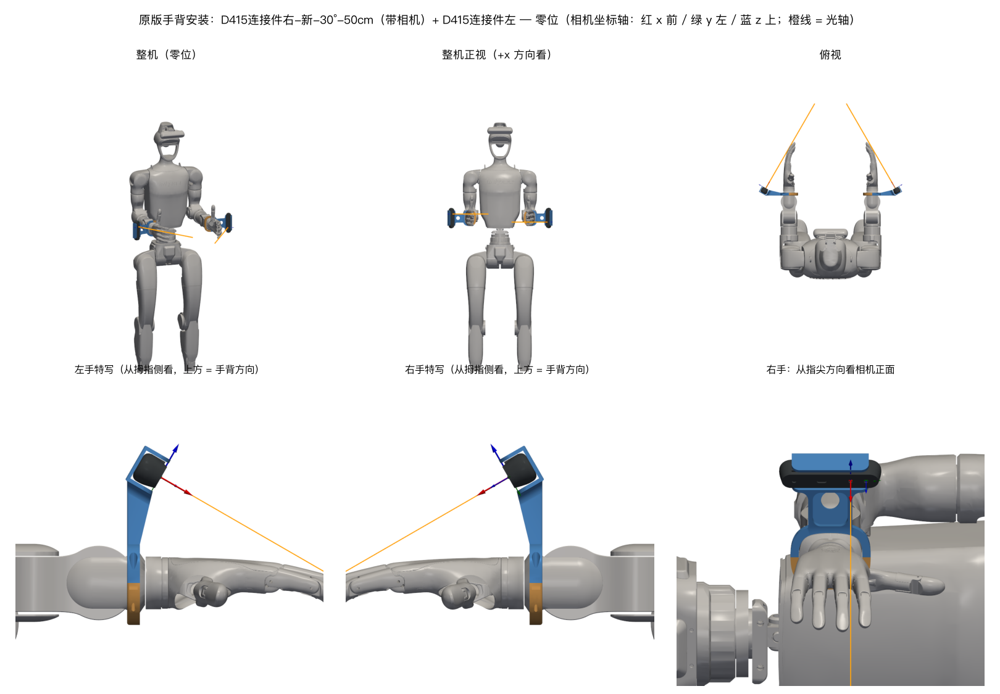
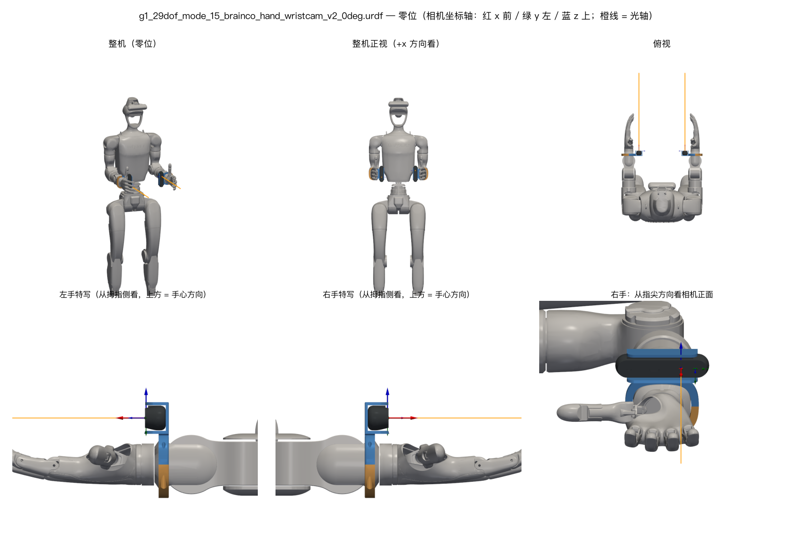

# Unitree G1 Wrist Camera Mounts (Intel RealSense D415)

This directory documents the 3D-printable wrist camera mounts developed for the
Unitree G1 + BrainCo hand setup used in **ζ₀ (Zeta0)**.

To keep the Git repository lightweight and within source-distribution limits,
the large `.stl` meshes and URDF camera FOV `.mp4` / `.gif` preview videos are distributed
in the verified release asset bundle (`hardware-wrist-camera-v1.tar.gz`) and
preserved on the archival branch `archive/legacy-v5-runtimes`. Every file's
ASCII-normalized name and SHA-256 digest is recorded in
[`assets_manifest.json`](assets_manifest.json).

## Mount variants and URDF previews

| Design | Mounting side | Available angles | Starter recommendation | URDF preview |
| --- | --- | --- | --- | --- |
| Paper mount (`wrist-camera-paper/`) | Back of hand | `+30°` (`d415_wrist_30deg.stl`, `d415_wrist_left.stl`) | Reproducing paper hardware layout | [30° preview](wrist-camera-paper/urdf_30deg.png) |
| Expanded mount (`wrist-camera-expansion/`) | Palm side | `-20°`, `-10°`, `0°`, `+10°`, `+20°` (`d415_wrist_*deg.stl`, `d415_wrist_right.stl`) | **`d415_wrist_0deg.stl` (0°)** for initial testing | [−20°](wrist-camera-expansion/urdf_neg20deg.png) · [−10°](wrist-camera-expansion/urdf_neg10deg.png) · [**0°**](wrist-camera-expansion/urdf_0deg.png) · [10°](wrist-camera-expansion/urdf_10deg.png) · [20°](wrist-camera-expansion/urdf_20deg.png) |

| Back of hand (Paper +30°) | Palm side (Expanded 0° — recommended starter) |
| :---: | :---: |
|  |  |

## Downloading STL meshes and camera FOV preview videos

Option 1 — GitHub Releases (`v0.2.0`):

```bash
# Download hardware-wrist-camera-v1.tar.gz from GitHub Releases, then verify:
curl -LO https://github.com/chenyizhi123/Zeta0/releases/download/v0.2.0/hardware-wrist-camera-v1.tar.gz
tar -xzf hardware-wrist-camera-v1.tar.gz -C hardware/
python -c '
import hashlib, json
from pathlib import Path
manifest = json.loads(Path("hardware/assets_manifest.json").read_text())
base = Path("hardware/hardware-wrist-camera-v1")
for entry in manifest["files"]:
    actual = hashlib.sha256((base / entry["path"]).read_bytes()).hexdigest()
    assert actual == entry["sha256"], f"Checksum mismatch: {entry[\"path\"]}"
print(f"Verified {len(manifest[\"files\"])} hardware assets OK")
'
```

Option 2 — Direct checkout from the archival branch (inside a full clone):

```bash
git checkout archive/legacy-v5-runtimes -- hardware/wrist-camera-paper hardware/wrist-camera-expansion
```

## Recommended 3D printing & assembly guidelines

| Parameter | Recommendation |
| --- | --- |
| Material | PETG, ABS, or PA-CF (avoid standard PLA near warm actuators / RealSense D415 body) |
| Layer height | `0.20 mm` |
| Wall loops / Perimeters | `4` |
| Infill | `30–40%` gyroid or cubic |
| Camera fasteners | Standard Intel RealSense D415 rear `M3` mounting screws (check thread depth `<= 5 mm` into camera body) |
| Cable routing | Add a zip-tie strain-relief loop along the forearm before the wrist joint to prevent USB-C disconnection during high-speed whole-body motions |

## Camera calibration & G1 software integration

After mounting the D415 on left/right wrists:
1. Verify each camera's live image and USB serial (sensor serial and USB serial can differ — see [`real/g1/README.md`](../real/g1/README.md#install-and-configure)).
2. Record the wrist serials in your local `real/g1/config/local.json` (`camera_sources`).
3. Verify frame alignment and 640x480 geometry with `bash real/g1/record_episode.sh --check --seconds 15` before collecting demonstrations.
